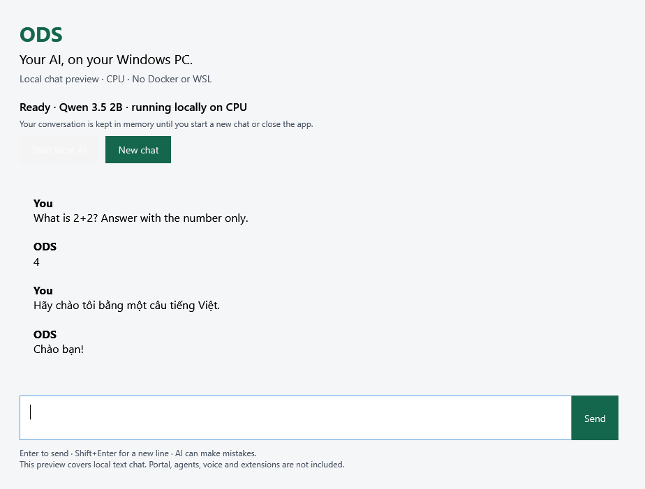

# Windows native desktop preview: validation and next boundary

The first milestone is **extract → open an EXE → acquire checked files →
chat locally → close without an orphan model process**. It introduces an
opt-in text-chat application alongside the existing installer. It does not
establish full modern ODS or Portal support on native Windows.



## Exact source and environment

- Product-source commit: `2de9c9cf12ee8ffeeb602492f7cb4271719f3d23`, based on
  upstream `c99f52822f2c37813fd880004f964ca83dfc5a35`.
- The initial documentation commit (`5c824ecb`) adds this receipt, the screenshot,
  the quickstart link and their build-copy steps; application/runtime/test
  sources are unchanged.
- The review-package follow-up expands entrypoint tests, CI packaging and
  reviewer instructions; application/runtime sources remain unchanged.
- Windows 10 Pro x64, build `10.0.19045`, dual Xeon E5-2686 v4, 80 GiB RAM;
  .NET Framework release `533325`, Microsoft native runtime `14.51.36247.0`.
- Checked official llama.cpp b9014 CPU x64 archive and the ODS catalog's
  `qwen3.5-2b-q4` model. Exact pins are generated from the archive/catalog by
  `build.ps1`; the [README](README.md) explains acquisition and prerequisites.
- No Docker/WSL commands or services are used by the application. This is a
  development host with those tools available, not a clean-machine claim.

## Results

| Boundary | Executed evidence | Limit |
| --- | --- | --- |
| Checked acquisition and recovery | Real local HTTP download, wrong length/hash, cache repair, mid-transfer cancellation and a response stalled after headers | Fixture transport; actual upstream acquisition is separately exercised below |
| Runtime publication | Manifest-only archive extraction, traversal entry excluded, SHA-256 checked before use, verified cache reuse, damaged-cache replacement and previous tree retention | No installer/update migration is implemented |
| Process custody | Real native children, authenticated loopback requests, correct model identity, normal shutdown and abrupt parent termination; foreign listener survives | Windows Job lifecycle, not a complete installed-service/fleet claim |
| WPF user flow | Actual buttons/dispatcher: setup, UTF-8 answer, empty-answer recovery, cancellation, restart, new chat and damaged seed/cache fallback | Automated framework interaction, not independent human UX acceptance |
| Model inference | Actual pinned CPU model answered the exact-token `2+2` probe with `4`, followed by a Vietnamese answer | Two smoke prompts; not a model-quality, performance or tool-use evaluation |
| First use from empty state | The GUI downloaded both upstream runtime and model; setup ready after **119.1 s**, then two real chat turns | Pre-final first-run source; final adds prerequisite guidance |
| Exact inference package | Test harness loaded the compiled EXE's real WPF window with `Assembly.LoadFrom`; setup using verified caches after **72.5 s**, then `4` and `Chào bạn!` | These inference probes use the loaded window; the separate entrypoint checks below start the actual EXE without inference |
| Executable entrypoint and packaging | Separate-process EXE launch from a Unicode path, duplicate-instance dialog with the original left running, incomplete-package recovery dialog, normal exit and reopen; repeated against the full build output | No setup/chat interaction through an external desktop driver; clean-machine qualification remains open |

The expanded native suite passes **55 checks**, including normal/refusal/recovery
controls and nine executable-entrypoint checks. Those nine also pass against
the complete build output. A deliberately broken EXE that exits before opening
the window fails the new entrypoint suite. The follow-up changes tests,
packaging and documentation; application/runtime sources remain unchanged.
PowerShell analysis, whitespace and the commit-identity gate pass.
The CI execution inventory includes the new Windows workflow invocation.
Hosted checks are tracked separately on the PR head; local results do not
assert hosted CI or maintainer acceptance.

Commands run from the repository root:

```powershell
powershell.exe -NoProfile -ExecutionPolicy Bypass -File ods/tests/test-windows-desktop-preview.ps1
powershell.exe -NoProfile -ExecutionPolicy Bypass -File ods/desktop/windows/build.ps1 `
  -OutputDirectory <new-output-folder> -RuntimeArchive <checked-official-archive>
powershell.exe -NoProfile -ExecutionPolicy Bypass -File ods/tests/test-windows-desktop-preview.ps1 `
  -UiBundle <output-folder> -UiState <isolated-qa-folder> -Screenshot <output.png>
```

The local ZIP is 108,551 bytes, containing the preview EXE, manifest and
documentation/notices. It contains no upstream runtime executable or DLL.
The demonstrated EXE's SHA-256 is
`3b9670ced4fd553d2ee4aeb5dea671d09657457af43c5e5f8392c1222c05558d`.
The screenshot comes from that package. Build outputs are not committed.

The review-package lane exports an unsigned ZIP from the Windows workflow.
`BUILD-INFO.json` identifies both the actual checkout SHA (a synthetic merge
commit on PR runs) and the PR head, plus the executable hash; `SHA256SUMS.txt`
identifies the ZIP. The default regression suite uses no downloads. The separate
package build acquires only the checked upstream archive to generate its manifest
and notices, excludes upstream binaries and launches the real built EXE before
upload. See the [README](README.md#open-the-preview) for reviewer download steps.

## Next integration boundary

The next meaningful product milestone is to run an existing modern ODS
conversation through a Windows-native backend while preserving the current
Portal contracts. That needs a producer/consumer inventory before porting:

1. Identify the Portal ingress, conversation/session state, artifact delivery,
   model-route selection and authenticated host operations that must remain
   interoperable with the existing UI and persisted data.
2. Replace Linux/systemd/socket/ownership assumptions with explicit Windows
   implementations. Preserve refusal and recovery behavior, credential
   custody and isolation of foreign installations/processes; do not disable
   the existing checks to make the UI boot.
3. Prove a real Portal turn and artifact delivery, cancellation, restart and
   recovery on a clean Windows machine, using the ODS model/Portal harness.
   Include an untouched supported installation as a compatibility control.
4. Qualify hardware-aware CPU/GPU selection and a redistributable runtime;
   then signed installation, updates, removal, first-run accessibility and
   independent human/fleet review before a general-public release.

This proposal does not select a new Portal architecture or replace the
supported Windows installer. The [runtime distribution gate](README.md#runtime-distribution-gate)
and the catalog model's existing qualification limits remain open.

## Provenance

This preview was developed collaboratively by tang-vu and Codex. tang-vu led
the contribution, defined its goals, scope and quality requirements, and provided
the development and validation environment. Codex assisted with implementation,
analysis, automated testing and static review. Command execution is recorded in
the validation evidence. A separate static review's cancellation, seed-recovery
and process-assignment findings were corrected and re-reviewed. The remaining
release gates are listed above.
