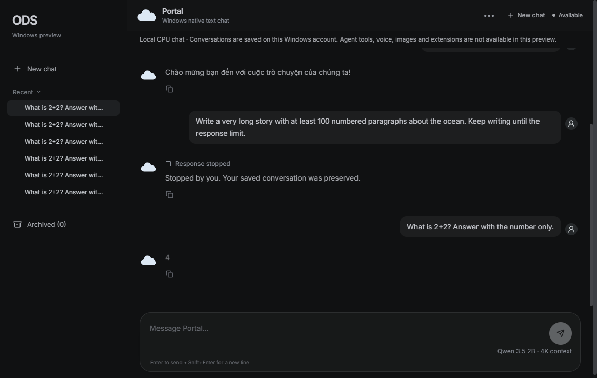
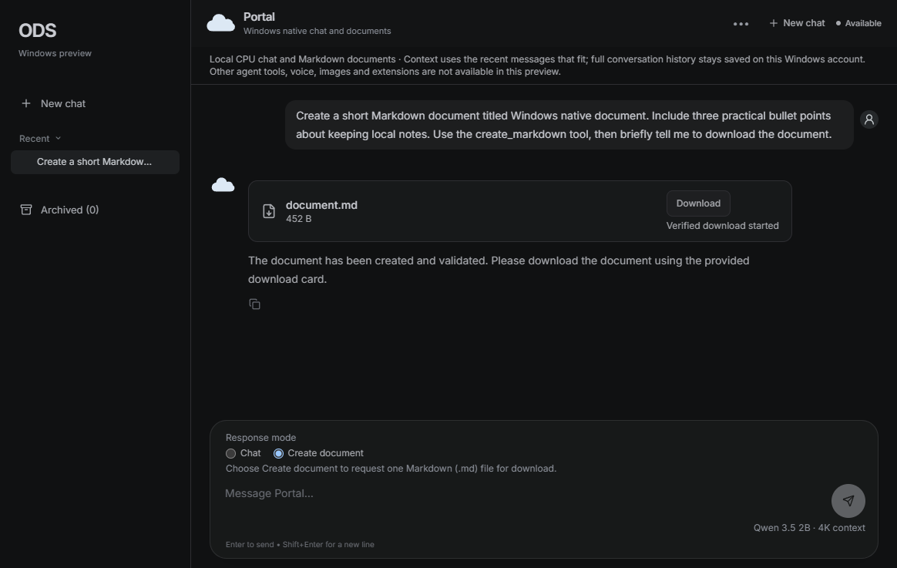

# Windows native Portal installer: validation

The demonstrated scope is **graphical install → native setup → existing Portal
→ CPU chat or explicit Create document → verified Download → Windows save
dialog → saved conversation → Stop/continue → reopen**. Full OpenClaw/Pixel
agents, host tools, workspace editing and the full ODS harness remain outside
this preview. The document capability is one bounded native Markdown tool.

## Source and environment

- Installer work is based on upstream main `72e59cdc6` (2026-10-22), merged into
  the existing preview branch. `BUILD-INFO.json` records the exact tested
  checkout and PR head separately, including synthetic PR merge checkouts.
- Windows 10 Pro x64 build 19045, dual Xeon E5-2686 v4, 80 GiB RAM; .NET
  Framework release 533325, WebView2 Runtime 155.0.4283.62.
- The installer lifecycle was executed with a **non-elevated** token on this
  development host. Docker/WSL exist on this host but were not used by the app.
  This is not a clean Windows result.
- Engine: llama.cpp b9014 source `d4b0c22f9e67f0295e91dc1ab4f17c0fb2557fa4`,
  LLVM-MinGW UCRT 20261020, static baseline x64 CPU; OpenMP/TLS/dynamic backends
  disabled. One exact missing-header portability patch is retained in the build
  receipt. PE imports were checked against the Windows system DLL allowlist.
- Locally qualified engine: 13,929,472 bytes, SHA-256
  `e356d042985363fbff84b5992aae3932a666aeae149cf1a8a9aef7fc894fef1a`.
  Hosted rebuilds have their own exact hashes; binary reproducibility across
  builders is not claimed.
- ODS catalog `qwen3.5-2b-q4`: 1,280,835,840 bytes, SHA-256
  `aaf42c8b7c3cab2bf3d69c355048d4a0ee9973d48f16c731c0520ee914699223`.
- WebView2 SDK 1.0.4258.31: SHA-256
  `56f7f4b8bf9aee4b8efefbbdd4f67d5f74ebd1b100ed0806da71bf76af481aa9`.
  Compiler, source archive, bootstrapper and tool pins are in
  `native-build-pins.json`. The WebView2 bootstrapper also passed the Microsoft
  Authenticode signer check.

## Executed local checks

| Boundary | Result | What it establishes |
| --- | --- | --- |
| Native regression suite | **264 passed** | Acquisition/cancellation, real Windows children, Job cleanup, storage capacity/recovery/API errors, exact-token context selection, cached repair/reopen, reflection errors, model/auth identity, Portal history/result/Stop, document publication/ownership/HTTP tool calls and runtime refusal |
| Actual EXE | **11 passed**, repeated on package | Real Main entrypoint, Unicode path, duplicate instance, incomplete-package recovery, reopen and side-effect-free idle/busy installation probe |
| Graphical installer lifecycle | **23 passed** | Real wizard cancellation/install/Finish launch; HKCU and Start Menu target; busy upgrade/uninstall refusal; data-retention notice/cancellation; repair; upgrade; downgrade refusal; failed directory inspection; descendant junction refusal; removal; foreign/saved-data preservation |
| Installed Portal UI | **11 passed** | Actual production frontend in WebView2, multi-turn text, history, New chat/select, Stop/recovery, external navigation/CSP refusal |
| Native document WebView flow | **31 passed** | Explicit mode, completed host receipt, real Markdown save/cancel, exact bytes/hash/path, small and >64 KiB JSON export, delayed owner choice, reopening without replay and default-path preservation |
| Real model document through Portal | **11 passed** | Genuine allowlisted model call, validated tool result and final answer, durable artifact/card, real cancel/save, exact document bytes/hash, idle slot and owned process shutdown |
| History after repair/upgrade/uninstall | **2 passed** | Actual saved Portal history remains readable, exact result bytes retained, no inference replay |
| Real included engine/model through Portal | **9 passed** | Math/Vietnamese; Stop/continue; over-context history fits without mutation; oversized latest prompt refuses before inference; next request succeeds; owned child closes and foreign listener remains |
| Real-model context negative control | **3 passed** | Prior unbounded request receives HTTP 400/context refusal; exact overflowing history fits without modification; corrected request answers 4 |
| Build and analysis | Passed | Source-built engine with PE dependency gate, .NET application, Inno compiler, pinned compiler/bootstrapper acquisition and PowerShell analysis |

Installer tests use a unique application ID, private install/data paths and
their own shortcut/registration. They do not install the default product into
the developer's real preview profile. Saved-history assertions operate on an
actual private WebView2/result fixture; they are not a separate claim about all
user profiles. Failed and completed fixture/log directories are retained for
inspection after owned uninstallation.

The model probe pressed the production WPF setup's real Start button and drove
Portal's actual DOM through WebView2. Verified-cache startup took **23.1 seconds**
on this host in the review follow-up (the earlier installer milestone took
76.2 seconds). The Vietnamese response was “Chào bạn! Rất vui được làm bạn.”
These single observations are not a controlled speed comparison. This is
automated framework-driven execution, not independent
human UX acceptance or a broader performance benchmark.

A first new-runtime live run passed two model turns but timed out in the
harness's read-only active-slot observation under concurrent setup work.
Only that observer now treats its two-second cancellation as unavailable and
continues the existing bounded wait for a real `is_processing=true`. The product
Stop/idle guard was not weakened. The subsequent six-check live run passed.

## Native Markdown follow-up (2026-10-23)

Chat stays the default. Explicit Create document admits one `create_markdown`
call with fixed `document.md`, strict UTF-8 and a 64 KiB bound. The actual tool
schema, requested output and tool result take part in both rendered-prompt
token budgets. The model receives the host's staged byte count/hash before its
final summary. No shell, host paths, file reads or network tools are exposed.

Only an atomic completed v2 receipt publishes a document; Markdown is inline in
that receipt, avoiding separate blob-file/orphan transactions. Reads revalidate
private file handles, ACLs, hashes and durable tombstones. The owner index selects
only relevant receipts, without treating cached bytes as authority. Shared
content remains available while another completed chat owns it. Stop, close,
provider failure and quota exhaustion after admission publish no document.
Existing v1 text results remain readable and are not rewritten or evicted.

Within the **264-check native suite**, document coverage includes **37** store
and path/ACL controls, **24** exact tool-budget controls, **27** admitted API,
quota, cancellation, restart and deletion controls, and **13** real authenticated
HTTP tool-round/history/refusal/cancellation checks. These are included in the
suite total. Four budget mutants were rejected, including loss of the tool-result
reserve, incorrect tokenizer flags, partial-turn trimming and dropped schemas.

The real model produced **452 bytes**, SHA-256
`cebf8f84fd67bb2fe662b9a84a00732fda13553deb2e0bc78f38606632cb79b3`,
containing the requested title and three practical notes. Actual WebView Download
verified and saved those bytes through the production Windows picker. The fixture
also exported complete **1,552-byte** and **74,173-byte** conversations as JSON.
Accepted Markdown/JSON choices were held for two seconds, beyond the frontend's
one-second Blob-URL revocation timer, and still completed with exact bytes.
Content integrity is not a claim about model factual quality or speed.

Independent static review caught the first download handler applying the Markdown
name/size cap to existing conversation exports. MIME/filename classification now
preserves JSON export and its Windows picker. Actual UI qualification then exposed
synchronous modal UI inside WebView2's download callback. The corrected handler
uses the pinned SDK's [deferred-post pattern](https://learn.microsoft.com/dotnet/api/microsoft.web.webview2.core.corewebview2.downloadstarting?view=webview2-dotnet-1.0.4258.31);
Cancel remains the default until explicit owner acceptance. That safety delta
was independently reviewed before the passing fixture/live-model runs.

Intermediate harness failures were retained: UIAutomation's root tree missed an
owned modal; script-only clicks lacked browser activation; a filename value echoed
without committing Shell edit notifications; and object marshalling reordered
expected JSON keys. The final driver binds controls to its exact PID/Portal owner,
uses native edit notifications and private-WebView input, compares raw saved
producer input to exported bytes, and runs from a private working directory with
an unchanged default-path sentinel. One 76-byte fixture output from the earlier
filename test was verified and preserved separately; no overwrite confirmation
was accepted. A protocol fixture initially asserted the wrong prior turn count,
and cleanup masked that assertion during child-handle release; the corrected
count and bounded cleanup pass in the final native run. These were failed
attempts, not additional passing results.

Installer version **0.2.0.0** separates this schema-capable build from the earlier
0.1 preview. Both PowerShell versions pass **8** numeric version/default/refusal
checks before package reads, downloads or output changes. The builder refuses
older labels. Setup's existing numeric downgrade guard protects an existing 0.2
installation; old portable EXEs and reinstalls after uninstall are outside that
guard. Earlier readers refuse document histories while preserving their bytes;
keep a backup and use 0.2 or newer to reopen them.

The full frontend run passed **3,035 tests across 253 files** on Windows, with
native and normal builds passing. ESLint reported **zero errors / 897 existing
warnings**. The new graphical fixture is executed explicitly in the path-filtered
native workflow; catalog-model execution remains a separately recorded local
gate, with no model download added to CI.

## Regression and review evidence

A separate static review found an installer safety gap: failed filesystem
enumeration could be treated as an empty/link-free tree. The corrected path
uses direct Win32 enumeration with retained last-error codes; only expected
absence/end-of-enumeration is accepted. An actual list-directory DENY ACL
regression now proves repair and uninstall refuse before changing owned bytes.
A substituted descendant junction likewise refuses both operations and
preserves the foreign target. The corrected safety delta was re-reviewed.

Earlier Portal work also fixed a late Stop overwriting a completed result and
changed model response consumption to authenticated cancellable SSE. Actual
inference confirms Stop can quiesce a live model while retaining it for another
turn. Portal still receives bounded completed text rather than incremental
frontend tokens.

The previously published Portal head `841854214` passed 74/74 hosted checks,
including **3,014 frontend tests across 252 files** on Linux, macOS and Windows.
Those are historical results. The review follow-up at `dfa6c744d` changes native
React behavior and passed **3,021 tests across 252 files locally on Windows**,
both native and standard frontend builds, and ESLint with zero errors (897
existing warnings). Hosted results are reported against the actual head on the
PR; prior green checks are not substituted for current-head validation.

### Community review follow-up

[IronicRayquaza's review](https://github.com/Osmantic/ODS/pull/7938#issuecomment-6345076519)
identified lifetime storage exhaustion, over-context conversations, slow-download
failure, duplicate startup hashing and wrapped constructor errors. The follow-up
keeps existing results accessible above the admission budget, preserves drafts
on typed HTTP 507 refusal, and handles deletion's separate error consumer.
Exact server template/tokenizer calls select complete recent turns while keeping
saved history unchanged and reserving 512 output tokens.

Real loopback regressions cover progressive downloads lasting multiple scaled
inactivity windows, stalled headers/body, cancellation and preservation of an
older cache. Cached source-built launches select an unverified candidate without
reading its bytes, then pass one mandatory CNG SHA-256 gate before creating a
child or session key. A corrupt installed seed repairs into private cache; a
second launch makes no extra download. Unsafe paths and runtime corruption never
authorize model repair. WPF tests cover nested reflection errors and distinct
setup timeout guidance. The two WebView2 version boundaries now share the pinned
SDK's **154.0.4258.31** minimum (14 boundary checks on PowerShell 5.1 and 7).

Independent static review checked the combined launch/repair paths and the
template/tokenizer contract against the shipped b9014 source. It caught and
resolved a repeated corrupt-seed download loop and loss of actionable DELETE
capacity guidance. New native tests run in the path-filtered **Windows native
preview** workflow; heavy build/model-free package/lifecycle tests are removed
from unrelated PRs' PowerShell lint job. The CI test inventory passes: 1,317
executed tests, 19 explicitly recorded live/platform exclusions.

An intermediate combined run exposed an asynchronous fixture-server teardown
failure. Its dedicated server thread now shuts down independently of blocked
thread-pool continuations; the final 163-check run passed. A separate installer
automation attempt saw an enumerated window disappear during inspection; its
harness now retries only `ElementNotAvailableException` within the existing
process-ownership and overall-timeout boundaries.

## CI and reproduction

[Build and test commands](README.md#build-from-source) are in the preview README.
Windows CI builds the pinned engine from source, builds the frontend and .NET
app, executes native/entrypoint/WebView2/installer tests, checks the binary
census, builds the installer and produces an isolated Sandbox QA kit.
It downloads no model weights. Frontend tests execute in dashboard CI.

The artifact includes an unsigned Setup EXE, portable ZIP, SHA-256 sums, build
receipts, installer logs and QA kit. The native package contains only its ODS
EXE, static CPU engine EXE and four allowed Portal/WebView2 DLLs. The separate
installer embeds the checked Microsoft WebView2 bootstrapper. Complete engine,
toolchain, frontend, SDK and installer-engine notices are retained.

## Deferred acceptance gates

- **Clean Windows first use**, especially missing WebView2 installation,
  prerequisite cancellation/failure and offline/proxy recovery. The prepared
  Sandbox kit records OS/token/tool availability, installer hash, real model
  results and screenshot; generating it is not successful guest execution.
  The local Sandbox feature was enabled with `-NoRestart`; Windows reports a
  required reboot, which has not been performed. No clean guest execution is
  claimed. A guest token is recorded rather than assumed non-elevated.
- Windows 11 and wider hardware qualification, accessibility and independent
  human review. A single non-elevated development host does not establish these.
- Signed public website release, SmartScreen reputation, authenticated update
  delivery/rollback and fleet acceptance. Current repair/manual-upgrade/removal
  tests do not qualify automatic updates. The application's idle probe is
  advisory, not an atomic update lock.
- Full OpenClaw/Pixel agents, host tools, workspace editing/delivery, voice, images,
  extensions, GPU routing and model switching. Unsupported controls/API routes
  remain refused rather than presenting incomplete services as ready.

The preview's data stays separate from existing ODS stacks. Uninstall removes
registered application files and leaves saved model/history state available.
The supported installer and normal Portal mode retain their existing defaults.

## Collaboration

tang-vu leads this contribution, its product direction, scope and quality
decisions, collaborating with Codex on implementation, analysis, automated tests
and review. Recorded command/test results were agent-executed. Maintainer review
and release acceptance remain separate gates.
